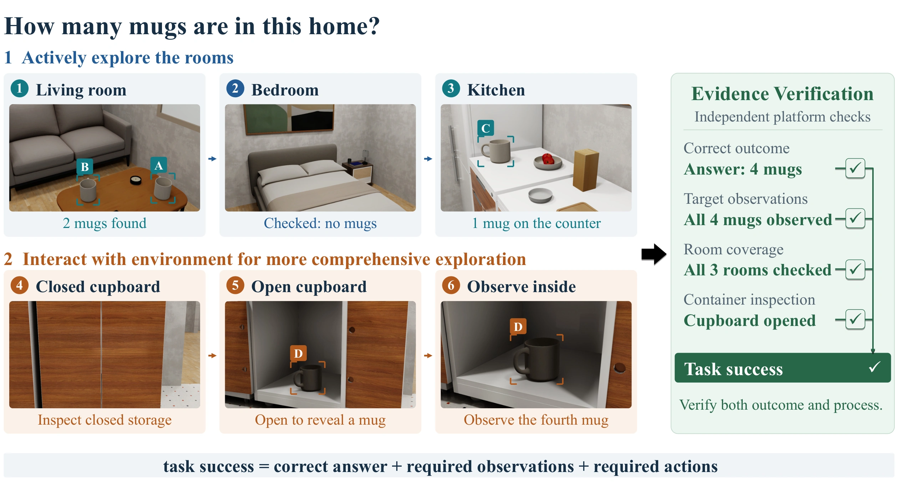

<h1 align="center">ROAM-Bench</h1>

<h3 align="center">
  Evaluating Embodied Active Spatial Intelligence<br>
  through Evidence Verification
</h3>

<p align="center">
  <a href="https://rxjfighting.github.io/">Xingjian Ran</a><sup>1,4</sup> &nbsp;·&nbsp;
  Xiaoye Mo<sup>2</sup> &nbsp;·&nbsp;
  Sihao Liu<sup>1</sup> &nbsp;·&nbsp;
  Li Luo<sup>1</sup> &nbsp;·&nbsp;
  <a href="https://wutaiqiang.github.io/">Taiqiang Wu</a><sup>1,4</sup><br>
  Ji Zhao<sup>3,4</sup> &nbsp;·&nbsp;
  <a href="https://wqshao126.github.io/">Wenqi Shao</a><sup>4</sup> &nbsp;·&nbsp;
  <a href="https://lhy-hongyangli.github.io/">Hongyang Li</a><sup>4</sup> &nbsp;·&nbsp;
  <a href="https://myownskyw7.github.io/">Jiaqi Wang</a><sup>4</sup> &nbsp;·&nbsp;
  <a href="https://daibo.info/">Bo Dai</a><sup>1</sup>
</p>

<p align="center">
  <sub>
    <sup>1</sup> The University of Hong Kong &nbsp;·&nbsp;
    <sup>2</sup> University of Electronic Science and Technology of China<br>
    <sup>3</sup> Shanghai Innovation Institute &nbsp;·&nbsp;
    <sup>4</sup> JD.com
  </sub>
</p>

<p align="center">
  <a href="https://arxiv.org/abs/2611.33143"><strong>Paper (arXiv)</strong></a> &nbsp;·&nbsp;
  <a href="https://rxjfighting.github.io/ROAM-Bench/"><strong>Project website</strong></a> &nbsp;·&nbsp;
  <a href="dataset/README.md"><strong>Task set</strong></a> &nbsp;·&nbsp;
  <a href="https://huggingface.co/datasets/xjran/ROAM-Bench-scenes"><strong>Scene assets</strong></a> &nbsp;·&nbsp;
  <a href="code/docs/environment.md"><strong>Environment construction</strong></a>
</p>



## Overview

ROAM-Bench evaluates how agents explore, reason about space, and act to complete tasks. It contains **250 validated tasks across 11 task types, five ability groups, and 27 indoor environments**. Independent checks score outcome correctness, task-required observations and interactions, and stronger corroboration.

Tasks cover object and room grounding, counting, metric measurement, direction judgments, and object relocation. Agents must choose where to move, look, and interact. Evaluating the full episode helps distinguish a correct outcome from completing the observations and interactions required by the task, and supports more detailed failure analysis.

The [project website](https://rxjfighting.github.io/ROAM-Bench/) presents task examples, paper figures, and the exploration demo. Its source is maintained separately on the `gh-pages` branch. The `main` branch contains the evaluation code, task set, documentation, and project media.

## Repository structure

```text
code/       Evaluation harness, Isaac Sim backend, asset builders, and tests
dataset/    250 task definitions and 388 reference images
media/      Paper teaser and scripted exploration demo
```

Large scene assets are distributed separately in the [Hugging Face environment repository](https://huggingface.co/datasets/xjran/ROAM-Bench-scenes). This repository contains no model credentials, simulator binaries, official robot assets, or experiment histories.

## Download scene assets

The environment repository contains one `.tar.gz` archive per scene. Download just one scene first, or use `--all` for all 27. The dataset ID is `xjran/ROAM-Bench-scenes`. Run from the repository root with Python 3.11:

```bash
python -m pip install -e './code[geometry,media,hub]'
python code/scripts/download_scenes.py --repo-id xjran/ROAM-Bench-scenes --scene scene_148 --output scenes
python code/scripts/build_environment.py --dataset dataset --assets scenes --scene scene_148 --inspect
```

```bash
python code/scripts/download_scenes.py --repo-id xjran/ROAM-Bench-scenes --all --output scenes
python code/scripts/verify_release.py
```

Selected archives are checked against `code/scene_archives.json` before extraction. Existing scene directories are never overwritten. For an existing download, select only the missing scenes. Archives occupy about **17.13 GB**; extracted scenes occupy about **19.68 GB**. Allow additional storage for the download cache and simulator resources. Public scene downloads do not require an access token.

To use archives obtained separately:

```bash
python code/scripts/download_scenes.py --source-dir /path/to/environment-repository --scene scene_148 --output scenes
```

Keep the environment repository's `manifest.json`, `asset_provenance.json`, and licenses with the scene directory. Preserve scene IDs and object aliases, which bind the environments to the task set.

## Build an Isaac Sim environment

Install [Isaac Sim 5.1.0](https://docs.isaacsim.omniverse.nvidia.com/5.1.0/installation/index.html) with Python 3.11 and a compatible NVIDIA GPU. Obtain official Unitree G1 and Inspire-hand assets separately. Run the following in the Isaac Sim Python environment:

```bash
python -m pip install -e './code[geometry,media]'
python code/scripts/build_robot_asset.py --source official_G1 --output robot
python code/scripts/build_environment.py --dataset dataset --assets scenes --scene scene_148 --robot-asset robot/g1_inspire.usda --output stages/scene_148.usda
```

The robot builder leaves the official source assets intact. Keep the official and derived robot directories accessible together. Task-specific scene variants are selected automatically in a separate cache. See [environment construction](code/docs/environment.md) and the provided Dockerfile for details.

## Evaluate a VLM

Provide a vision-capable Chat Completions endpoint and set your own credentials:

```bash
export ROAM_BENCH_API_KEY=YOUR_API_KEY
python code/scripts/evaluate.py --dataset dataset --assets scenes --robot-asset robot/g1_inspire.usda --model YOUR_MODEL --base-url YOUR_BASE_URL --output results/model.json
python code/scripts/summarize.py results/model.json
```

Use `--scene`, `--task-id`, `--group`, or `--limit` to select tasks. Add `--resume` to continue an interrupted run with matching code, tasks, images, and settings. See [protocol settings](code/docs/protocol.md) and [episode outputs](code/docs/episode.md).

The model selects predefined atomic actions; the platform executes them under robot motion and interaction constraints. Ground-truth scene semantics and evaluation annotations remain inside the evaluator. The model receives task instructions, permitted reference images, RGB observations, and declared robot feedback.

Scores are **A**, outcome correctness; **N**, task-required observation and interaction checks; **S**, stronger corroboration including N; and **T = A ∧ N**, task success. S is a separate diagnostic and does not guarantee a correct answer.

## License

Code, task annotations, and benchmark-authored assets use the [MIT license](LICENSE). Third-party resources retain their source licenses; see [third-party notices](THIRD_PARTY_NOTICES.md). Isaac Sim and official G1/Inspire assets are obtained separately under their own terms.
